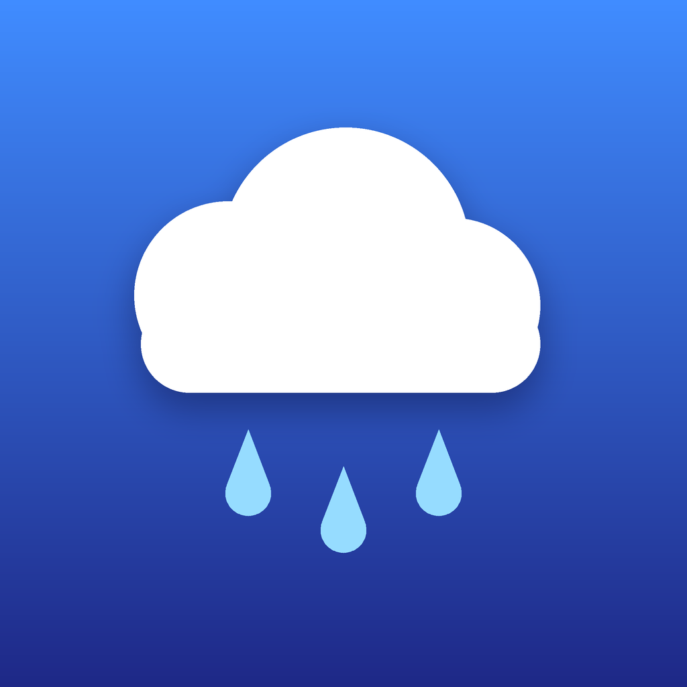

# Odema: rain alerts for your iPhone

Odema is a small iPhone app that sends you a notification **before rain arrives** at the places you choose: home, work, your parents' town, wherever.

It asks **every free public weather API it can reach** (12 forecast feeds) and alerts you only when enough of them agree. No account, no API keys, no server: the app runs on your phone and sends the alerts itself.

<p align="center"></p>

## What it does

- **Choose places** by searching a name, using your current location, or dropping a pin on a map.
- **Background checks.** iOS wakes Odema every 15–60 minutes. It fetches all sources for every place, and if rain is on the way you get something like:
  > **Rain soon in Paris**
  > Starting around 19:15 (in 35 min) · light, up to 1.2 mm/h · 9 of 12 sources agree
- **One alert per rain spell.** You won't get pinged every 15 minutes while it rains. There are also a cooldown and optional quiet hours (alerts wait until morning if the rain is still coming).
- **See the evidence.** Each place has a 12-hour chart of how many sources expect rain, plus what each source says (rain at 19:15, dry, not available here, or an error).

## Weather sources

All free and keyless. Sources that don't cover a place are skipped automatically.

| Feed | API | Coverage | Detail |
|---|---|---|---|
| MET Nowcast (radar) | api.met.no | Nordic countries | 5-minute steps, next 2 h, radar-based |
| Open-Meteo Best Match | api.open-meteo.com | Worldwide | 15-minute steps, blends the best local models |
| ECMWF IFS | api.open-meteo.com | Worldwide | hourly |
| NOAA GFS | api.open-meteo.com | Worldwide | hourly |
| DWD ICON | api.open-meteo.com | Worldwide, high-res over Europe | hourly |
| Météo-France ARPEGE/AROME | api.open-meteo.com | Worldwide, high-res over France | hourly |
| UK Met Office | api.open-meteo.com | Worldwide, high-res over UK | hourly |
| Environment Canada GEM | api.open-meteo.com | Worldwide, high-res over Canada | hourly |
| JMA | api.open-meteo.com | Worldwide, high-res over Japan | hourly |
| MET Norway Locationforecast | api.met.no | Worldwide | hourly |
| US National Weather Service | api.weather.gov | United States | hourly chance of precipitation |
| DWD MOSMIX (via Bright Sky) | api.brightsky.dev | Near ~5,000 stations worldwide | hourly |

Place search uses Open-Meteo's geocoding API (GeoNames data). Names for "current location" and map pins come from Apple's geocoder.

### How the decision is made

1. For each source, every forecast step in the alert window (2 hours by default) is checked. A step counts as **rain** if it reaches the amount threshold (0.2 mm/h by default) **or** the probability threshold (60% by default).
2. Each source with data votes "rain" or "dry". The radar nowcast counts ×2 and Open-Meteo's high-resolution blend counts ×1.5, because they are the best at "the next hour". A dry vote from a short-range source only counts for the part of the window it actually covers.
3. If the weighted share of "rain" votes reaches your agreement setting (half by default), Odema alerts. The start time is the weighted median of the sources' start times.

You can change all of this in **Settings**: look-ahead window, thresholds, how many sources must agree, cooldown, quiet hours, and which sources to use.

## Put it on your iPhone

Apple only lets you install apps outside the App Store by signing them with your own Apple ID. There are two ways.

### Option A: with a Mac (recommended)

1. Install **Xcode 16 or newer** from the Mac App Store.
2. Get the code: `git clone https://github.com/CLAY-NOVA/ODEMA.git`, or download the ZIP from GitHub.
3. Open **`Odema.xcodeproj`**.
4. Click the **Odema** project → **Odema** target → **Signing & Capabilities**:
   - **Team:** choose *Add an Account…* and sign in with your normal Apple ID. A free account works.
   - If Xcode says the bundle identifier is taken, change `com.odema.rainalert` to something unique, such as `com.yourname.odema`.
5. Plug in your iPhone, unlock it, and tap **Trust** if asked.
6. On the iPhone, turn on **Settings → Privacy & Security → Developer Mode**. The phone restarts.
7. In Xcode, pick your iPhone at the top and press **▶ Run**.
8. The first time, go to iPhone **Settings → General → VPN & Device Management** and trust your developer certificate.

With a free Apple ID the app stops opening after **7 days**. Connect the phone and press Run again to renew it; your places and settings are kept. A paid Apple Developer account ($99/year) extends this to a year.

### Option B: without a Mac

Every push builds an **unsigned `.ipa`** on GitHub's macOS machines:

1. Open the repository's **Actions** tab → the latest successful **iOS build** run → download **Odema-unsigned-ipa**. If a release tag `v*` exists, it's also attached to the **Releases** page.
2. Install it with a sideloading tool such as **[Sideloadly](https://sideloadly.io/)** (Windows/Mac) or **[AltStore](https://altstore.io/)**. These sign the app with your own Apple ID.
3. Turn on Developer Mode and trust the certificate, as in steps 6 and 8 above.

The same 7-day limit applies with a free Apple ID; AltStore can refresh it automatically.

## First launch

1. **Allow notifications.** That's how alerts reach you.
2. Tap **+** and add places: search, **Use my current location**, or **Pick on the map**.
3. Optional: **Settings → Send a test alert** to check notifications work.

### Getting reliable alerts

iOS decides when apps run in the background, based on how much you use them, battery level and network. To give Odema the best chance:

- Keep **Settings → General → Background App Refresh** on, both globally and for Odema.
- **Don't swipe Odema away** in the app switcher. Force-quitting stops background refresh until you open it again.
- **Low Power Mode** pauses background refresh.
- Opening the app always refreshes immediately.

A place added with *Use my current location* follows you, but only updates its position while the app is open, because Odema only asks for "While Using" location access.

## For developers

```
Odema.xcodeproj         Xcode project (Xcode 16+, synchronized folder: new files are picked up automatically)
Odema/                  SwiftUI app: screens, background refresh, notifications, location
Config/Info.plist       background task identifier and background mode
RainKit/                Swift package with all the weather logic (builds and tests on macOS and Linux)
  Sources/RainKit/
    Providers/          one file per API
    RainAnalyzer.swift  consensus across sources, chart timeline
    AlertPolicy.swift   when to alert (spells, cooldown, quiet hours) and the alert wording
  Tests/RainKitTests/   unit tests using real responses recorded from each API
.github/workflows/      CI: tests + unsigned iPhone build
```

Run the tests (no network needed):

```sh
cd RainKit
swift test
```

Check every API live:

```sh
RAINKIT_LIVE=1 swift test --filter LiveAPITests
```

To trigger a background refresh on a connected iPhone, run the app from Xcode, pause the debugger, and enter:

```
e -l objc -- (void)[[BGTaskScheduler sharedScheduler] _simulateLaunchForTaskWithIdentifier:@"com.odema.rainalert.refresh"]
```

### Adding a source

Implement `WeatherProvider` (one `fetch` method that returns `PrecipitationSample`s), add a case to `SourceID`, and register it in `ForecastService.defaultProviders`. Providers that need an API key (OpenWeatherMap, Tomorrow.io, Pirate Weather…) fit the same shape.

## Data and licences

- Open-Meteo: [CC BY 4.0](https://open-meteo.com/en/licence). Free for non-commercial use, up to 10,000 calls a day per device.
- MET Norway: [CC BY 4.0](https://api.met.no/doc/License). Odema identifies itself with a User-Agent as MET's terms require.
- US National Weather Service: public domain.
- DWD MOSMIX via Bright Sky: DWD open data, [terms](https://www.dwd.de/EN/service/copyright/copyright_artikel.html).

Odema is a convenience tool. It is **not** an official warning service, so follow your national weather service for severe weather.
