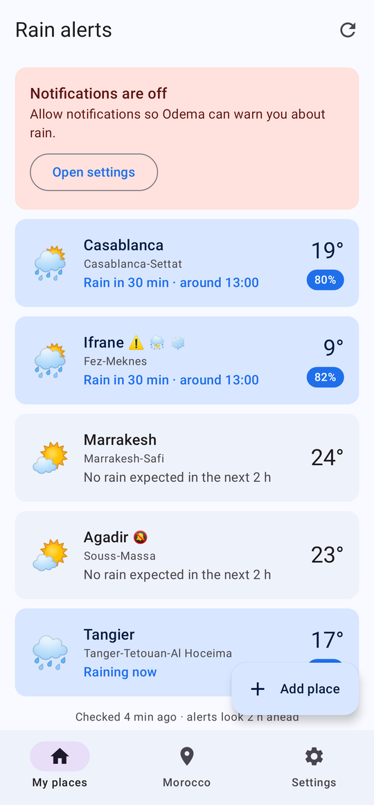
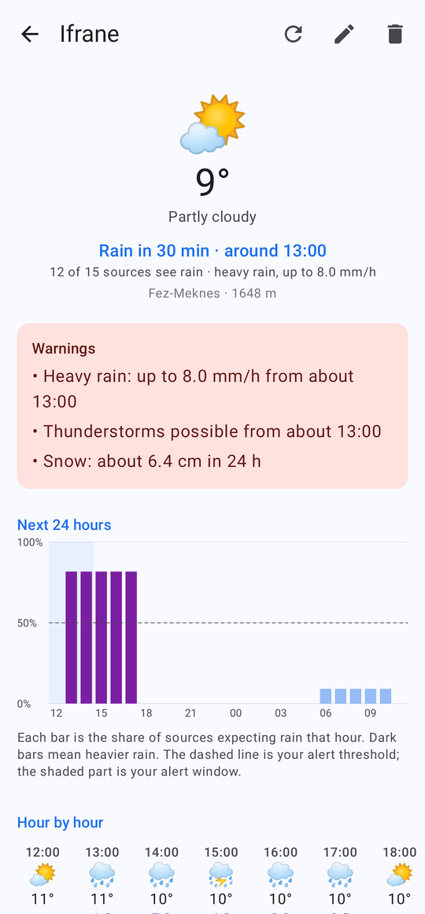
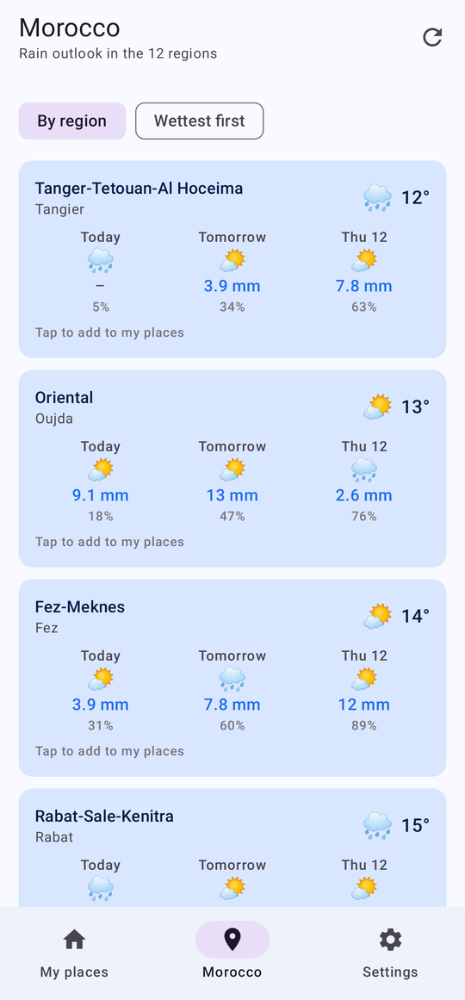
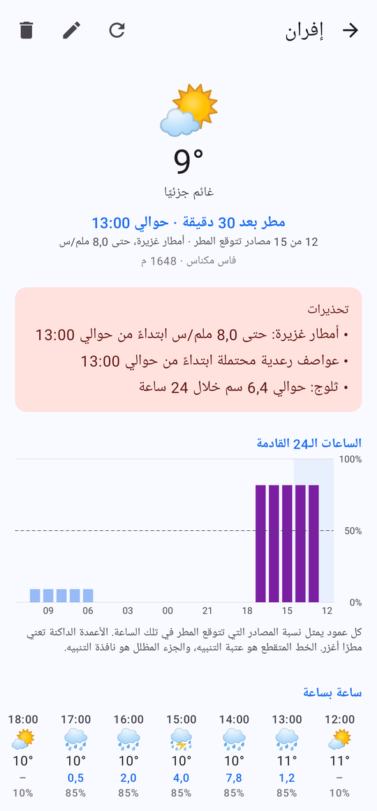
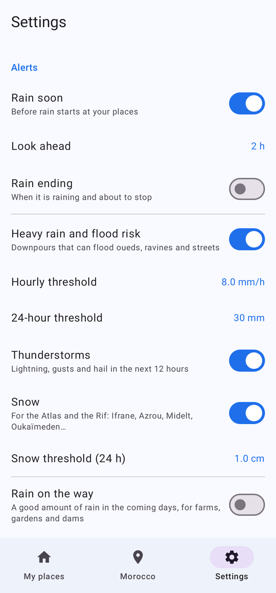
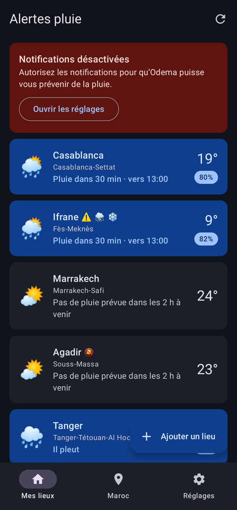

# Odema Maroc: rain alerts for Morocco (Android)

An Android app that warns you **before rain, heavy downpours, thunderstorms or snow** reach the Moroccan places you care about. It runs entirely on your phone: no account, no server, no API keys.

Available in **العربية · Français · English**, with full right-to-left support.

| | | |
|---|---|---|
|  |  |  |
|  |  |  |

## Install it on your Android phone

You need Android 8.0 or newer (almost every phone from 2017 onwards).

### Option 1: download the APK on the phone (easiest)

1. On your phone, download **`OdemaMaroc.apk`** from one of these:
   - the file shared with you, or
   - this repository's **Releases** page, if a release has been published: `https://github.com/CLAY-NOVA/ODEMA/releases/latest`, or
   - the **Actions** tab → latest green **Android build** run → **OdemaMaroc-apk**. You need to be signed in to GitHub, and the download is a ZIP you must open first.
2. Tap the downloaded file (in the notification, in Chrome's downloads, or in the **Files** app).
3. Android asks to allow installs from this source. Tap **Settings**, switch on **Allow from this source**, then go back.
4. Tap **Install**. If **Play Protect** warns about an unknown app, tap **More details → Install anyway**. The app isn't on the Play Store, so Google hasn't scanned it; the full source code is in this folder.
5. Open **Odema Maroc**.

### Option 2: install from a computer over USB

1. On the phone: **Settings → About phone**, tap **Build number** 7 times to unlock developer options. Then **Settings → System → Developer options → USB debugging**: on.
2. Install [Android platform tools](https://developer.android.com/tools/releases/platform-tools) (`adb`) on the computer and connect the phone with a cable. Accept the "Allow USB debugging?" prompt on the phone.
3. Run:
   ```sh
   adb install -r OdemaMaroc.apk
   ```

### Option 3: build it yourself

With [Android Studio](https://developer.android.com/studio): **File → Open** the `android` folder, plug in your phone, press **Run ▶**.

Or from a terminal (JDK 17+ and the Android SDK installed):

```sh
cd android
./gradlew :app:assembleRelease
# APK: app/build/outputs/apk/release/app-release.apk
```

### Updating

Install a newer APK over the old one, using the same steps. Your places and settings are kept. Every build here is signed with the same key (`app/signing/`), so updates always install over each other.

## First launch: 2 minutes of setup

1. **Allow notifications** when asked. Alerts can't reach you without this.
2. Tap **Add place** and pick one or more of:
   - **Moroccan towns:** 108 towns in all 12 regions, with their real elevations (Ifrane 1,648 m, Oukaïmeden 2,637 m…);
   - **Search:** any town, village or douar in Morocco;
   - **Use my current location:** a place that moves with you;
   - **Pick on the map:** tap anywhere on an OpenStreetMap map of Morocco.
3. **Settings → Allow checks in the background.** This stops Android's battery saver from delaying your alerts.
4. Optional: long-press the home screen → **Widgets** → **Odema rain** for the next rain at your main place.
5. Optional: **Settings → Send a test alert** to see an alert arrive.

### Phones that kill background apps

Some brands stop background apps aggressively. If alerts arrive late:

- **Xiaomi / Redmi / POCO:** Settings → Apps → Odema Maroc → **Autostart** on; **Battery saver → No restrictions**.
- **Samsung:** Settings → Battery → Background usage limits → remove Odema from **Sleeping apps**, or add it to **Never sleeping apps**.
- **Huawei / Honor:** Settings → Battery → App launch → Odema → **Manage manually**, all switches on.
- **Oppo / Realme / Vivo / OnePlus:** Settings → Battery → Odema → **Allow background activity**.
- Don't swipe Odema away in the recent-apps screen.

More at [dontkillmyapp.com](https://dontkillmyapp.com).

## What it watches, and how it decides

### 15 forecast sources (all free, no key)

| Source | What it is | Weight |
|---|---|---|
| Open-Meteo Best Match | Blend of the best models for Morocco: Météo-France ARPEGE, DWD ICON-EU, ECMWF. 15-minute steps for 24 h, hourly to 7 days | ×1.5 |
| ECMWF Ensemble | 51 runs of the European model; the share of runs with rain is a real probability | ×1.5 |
| NOAA GEFS Ensemble | 31 runs of the US model | ×1.2 |
| DWD ICON Ensemble | 40 runs of the German model | ×1.2 |
| ECMWF IFS 9 km, ECMWF AIFS (AI), Météo-France ARPEGE, DWD ICON, UK Met Office, NOAA GFS, Environment Canada GEM, JMA, CMA GRAPES | Nine independent national models, each checked to have real data over Morocco | ×1 each |
| MET Norway | Worldwide forecast with its own post-processing | ×1 |
| DWD MOSMIX stations (Bright Sky) | Statistical forecasts for Moroccan weather stations: Tanger, Casablanca, Fès-Saïs, Marrakech, Agadir, Oujda… (within 50 km) | ×1 |

Each place's own elevation is passed to the models, so mountain towns aren't averaged with the valleys below.

### Alert types (each can be switched on or off)

| Alert | When | Default |
|---|---|---|
| 🌧️ **Rain soon** | Enough sources expect rain within your look-ahead window (30 min to 12 h) | On, 2 h |
| 🌤️ **Rain ending** | It's raining and most sources expect it to stop within the hour | Off |
| ⚠️ **Heavy rain / flood risk** | Heaviest 60 minutes ≥ 8 mm, or ≥ 30 mm in 24 h (both adjustable) | On |
| ⛈️ **Thunderstorms** | Thunder codes from the models in the next 12 h | On |
| ❄️ **Snow** | ≥ 1 cm in 24 h (adjustable); for the Atlas and the Rif | On |
| 💧 **Rain on the way** | ≥ 10 mm over the next 1–7 days, for farms, gardens and dams | Off |
| ☀️ **Daily summary** | Each morning at the time you choose | Off |

How a decision is made:

1. Each source votes "rain" for a time step if it forecasts at least your **minimum amount** (default 0.2 mm/h) **or** your **minimum chance** (default 60%).
2. Votes are weighted (table above). A source that covers only part of the window only vouches for that part.
3. You're alerted when the weighted share of "rain" votes reaches your **agreement level**: 50% by default, or 35% for severe weather, where models rarely agree on exact amounts. The **Alert style** setting switches between Sensitive, Balanced and Strict in one tap.
4. **One alert per spell:** you're not pinged again until the forecast has been dry. A cooldown merges spells that are close together, and **quiet hours** hold alerts until morning (severe alerts can still come through).
5. If an API is down, the app keeps using that source's last good data for up to 6 hours. Models that only update every few hours are re-downloaded at most hourly, to stay within free limits.

### Every option

- **Alerts:** each alert type on/off; look-ahead; heavy-rain hourly and 24 h thresholds; snow threshold; multi-day window and amount; daily summary time.
- **Accuracy:** preset (Sensitive, Balanced or Strict); agreement for normal and severe alerts; minimum rain rate; minimum probability; each of the 15 sources on/off.
- **Notifications:** cooldown (1–12 h); quiet hours with start and end; severe alerts during quiet hours; sound and vibration per alert type (Android channels); test alert.
- **Background:** check every 15, 30, 60, 120 or 180 min; Wi-Fi only; pause on low battery; battery-optimisation exemption; check now.
- **Per place:** alerts on/off, rename, delete, show in widget, reorder.
- **Appearance:** language (phone, Arabic, French or English); theme (phone, light or dark).
- **Morocco tab:** today, tomorrow and the day after for all 12 regional capitals, sorted by region or wettest first. Tap one to add it to your places.

## Limits, honestly

- Android decides exactly when background checks run, so "every 15 min" can become 20–40 minutes with Doze or battery saver. The cooldown and lead time are there to absorb that.
- Open-Meteo's free tier allows 10,000 calls a day per phone. With 5 places and 30-minute checks Odema uses about 1,500.
- Morocco has no public weather-radar feed, so short-term rain comes from 15-minute model output and ensembles rather than live radar.
- This is a personal tool, not an official warning service. For severe weather follow the **Direction Générale de la Météorologie** ([marocmeteo.ma](https://www.marocmeteo.ma)) and the authorities.

## For developers

```
android/
  core/   pure Kotlin: providers (one per API), consensus and hazard analysis, alert policy,
          Moroccan towns/regions/bounds, geocoder. JVM unit tests with real recorded API responses.
  app/    Jetpack Compose UI, WorkManager background checks, notifications, widget,
          EN/FR/AR strings. Robolectric tests run the real worker and render the real screens.
```

```sh
./gradlew :core:test                                   # 36 core tests
./gradlew :app:testDebugUnitTest                       # worker + screen tests; screenshots in app/build/screenshots
./gradlew :core:test -Plive --tests '*LiveTest*'       # call the real APIs for Casablanca, Ifrane, Marrakech, Dakhla
./gradlew :app:assembleRelease                         # signed APK
```

To publish a release with the APK attached, push a tag: `git tag android-v1.0.0 && git push origin android-v1.0.0`. CI builds the APK and attaches it.

Data: Open-Meteo (CC BY 4.0), MET Norway (CC BY 4.0), DWD via Bright Sky, GeoNames, © OpenStreetMap contributors.
